# Mercador — "O Mercador Cúmplice"

Sucessor de [eliteAndroid](https://github.com/lsantosnet-dot/eliteAndroid): um jogo de comércio e intriga política
em Android nativo (Kotlin), com o voo do Elite entre uma estação e outra. O design completo está em
[`docs/DESIGN-MERCADOR.md`](docs/DESIGN-MERCADOR.md).

**Decisão D1 (design, seção 12):** projeto novo. Reaproveita apenas ideias do original (núcleo em Kotlin puro
testável sem Android SDK, universo por semente, economia por mercadoria). **Revista:** o voo 3D, o combate e o
wireframe do eliteAndroid foram portados para `core/flight` (física, IA e os modelos de nave do Elite) e
desenhados em Compose: sair da estação, saltar e chegar agora se pilota.

## Estrutura

```
core/   Kotlin/JVM puro, testável sem Android SDK
  rng/       SplitMix64: mix64, derive (árvore de sementes por hash), Rng
  universe/  Universe (galáxia → setor → sistema, acesso direto), traços, facções e relações
  universe/Region  região jogável de 50 sistemas, distâncias, vizinhos e conectividade
  world/     Meters/MeterModel (controle, descontentamento, abastecimento, pressão de revolta), World (deltas do mundo vivido, preços com volume; com `living`, crises com prazo e revoltas que trocam o dono do sistema e as leis) e Crisis
  game/      Save (GameSave, SaveCodec, SaveStore: salvamento só do mundo vivido), Slots (vários jogos salvos), Game (comprar, vender, viajar, livro de contas, jornal, preços vistos e lucro estimado, empréstimo/frete de socorro), Ship (melhorias da nave), Contracts (entrega, carga lacrada, socorro), Campaign (dívida com o agiota, parcelas e epílogo), Standing (atenção e reputação por facção), Pursuit (respostas à perseguição), Confrontation (cena em rodadas), Traits (traços e pessoas), Bar (rumores, segredos e crises à venda)
  story/     Storylet/StoryEngine (eventos com condições e lacunas), StoryContent + StoryContentLote2..4 (72 storylets), InnerVoice (voz interior)
  economy/   Commodity (12 mercadorias), Laws (ideologia → contrabando) e Market (preço/estoque por sistema e dia)
  flight/    o voo do Elite, portado do eliteAndroid sem LibGDX: FlightModel (MVEIT, atracação, planeta/sol/estação, salto
             curto, witchspace), Combat (TACTICS, piratas, polícia, caçadores, mísseis, E.C.M., contêineres), PlayerShip,
             DiscShips/OriginalShips (os 31 modelos originais), WireframeProjector (LL9), Scanner, Stardust e
             FlightSession (liga o voo ao Game: combustível, salto, recompensas, atenção da polícia, nave destruída)
app/    App Android (Activity + ViewModel que guarda o jogo; reaproveita o código de ui/ sem as classes só de PC). Só entra no build com Android SDK
ui/     Interface Compose (dossiê noir): tema, voo (FlightScreen: vista 3D em arame, painel com radar e bússola, manche,
        acelerador, gatilho e botões), telas (Mapa com crises, contratos e lucro estimado, Estação com mercado/contratos/estaleiro/dossiê/bar, Epílogo, animações (Cinematics: atracação, interceptação, revolta, estaleiro), animação de hiperespaço no salto, Dossiê, Livro, Perseguição, Confronto, História, Relatório), GameController (estado e ações) e AppRoot (navegação); Preview renderiza PNGs sem janela
docs/   Design e protótipo visual (docs/mercador)
```

Ainda falta a edição de nome dos jogos salvos na interface e testar o app num aparelho/emulador (o APK compila, mas nunca foi executado).

## Como se joga

Um jogo novo começa com uma **dívida de 24 000 cr** com um agiota e prazo no dia 300. Ele cobra em parcelas
(dias 75, 150 e 225); perder uma engorda a dívida e manda um cobrador. Quitada ou não, um **epílogo** lê o seu
livro de contas, e o jogo segue em modo livre.

- **Contratos** (aba da estação, até 3 ao mesmo tempo): entregas com prazo que pagam mais que o mercado, **socorro** a
  sistemas em crise e **carga lacrada** "sem perguntas", que ocupa o porão e só no fim revela o que era. A **carta
  lacrada** vem de uma história (um governador corrupto escreve ao rival): vira contrato para o sistema do rival mais
  perto, não ocupa o porão e paga na entrega; numa revista a alfândega pode achá-la (o compartimento oculto a esconde),
  e carta apreendida ou fora do prazo custa o favor e manda um emissário do governador atrás de você.
- **Estaleiro**: porão (até 50 t), tanque, motor de salto; no mercado negro (corrupção alta), compartimento oculto e
  transponder falso. Cada melhoria só se vende em certos sistemas.
- **Mapa útil**: o cartão do sistema mostra quanto a sua carga renderia lá (pelos preços que você viu ou comprou no
  bar), a melhor compra daqui para lá, crises e destinos de contrato.
- **Mundo vivo**: fome, epidemia, bloqueio, guerra, festival e veios descobertos surgem e acabam, inflacionando o que
  falta (e o bar sabe da próxima antes). Entregar o que falta encerra a crise antes. Sistemas sob pressão (muito
  descontentamento e pouco controle) se revoltam: a cor no mapa e as leis mudam. Armas seguram um regime; livros o derrubam.
- **Animações**: além do túnel do hiperespaço (que toca quando a contagem do voo chega a zero), a atracação na estação (a Coriolis girando até alinhar a fenda),
  a interceptação pela patrulha (radar, sirene e faróis), a revolta de um sistema no caminho (a cor velha racha e a
  nova inunda) e a instalação de melhorias no estaleiro. Tocam em sequência e um toque pula.
- **Voo**: na estação, **Decolar** (ou, no mapa, **Decolar rumo a…**) põe a nave no espaço com a estação atrás e o
  planeta à frente, como no Elite. O hiperespaço é pilotado: escolha o destino (botão **Destino**), afaste-se da massa
  da estação (~8 km) e toque **Hiper** para a contagem de 15 — dá para cancelar, e os tiros não param. Na chegada o
  planeta está longe e o sol atrás: aponte para o planeta (a seta na borda guia) e use o **Salto** curto, que não
  funciona com naves por perto; perto do planeta a estação surge. Atraque entrando alinhado na fenda (ela gira) ou,
  a menos de 6 km, com o computador de atracação (**Atracar**). Bater rápido na estação, no planeta ou chegar perto
  demais do sol destrói a nave: a cápsula te leva de volta, a seguradora cobra a franquia e a carga se perde.
- **Combate**: piratas, caçadores de recompensa, comerciantes e a polícia do Elite (mesma IA, mesmos modelos), mais
  comuns onde a vigilância é baixa. Manche à esquerda (arrastar), acelerador, **Fogo** (segurar) e **Míssil**
  (arma → trava na mira → lança). Abater pirata paga a recompensa do original; atirar em inocentes ou na estação
  esquenta a polícia local (e a estação lança Vipers); abater polícia te faz fugitivo. Carga ilegal no porão atrai
  Vipers. O estaleiro vende o **laser de combate** (feixe e militar) e a estação rearma os 3 mísseis.
- **Witchspace**: em ~3% dos saltos o hiperespaço falha no meio do caminho; metade do combustível já queimou e quatro
  Thargoids com seus Thargons vêm atrás. Lute ou salte de novo para o mesmo destino (só falta a outra metade).
- No PC, pelo teclado: setas = manche, espaço/shift = acelerar/frear, A = laser, H = hiperespaço, J = salto curto,
  M = míssil, C = atracar, F1–F4 = vistas, T = destino.
- **Mais histórias**: 60% das chegadas e saltos trazem uma, incluindo encontros sobre crises, revoltas, a carga
  lacrada e o agiota.

## Roteiro (seção 11 do design)

1. ✅ **Dados e gerador** em Kotlin puro, com testes — universo, sistemas, facções, mercadorias, preços por sistema e região de 50 sistemas
2. ✅ Laço de comércio + medidores (controle, descontentamento, abastecimento) — com simulação de 1 ano (risco R2)
3. ✅ Leis, atenção e perseguição por decisões (sem o confronto, que é a etapa 4)
4. ✅ Confronto por rodadas, traços e livro de contas
5. ⬜ Storylets e voz interior
6. ✅ Polimento visual "dossiê noir": tema e as 4 telas das maquetes em Compose, renderizadas de verdade em [`docs/ui`](docs/ui)

## Build

### Android Studio

Abra a pasta do repositório (`File ▸ Open`), deixe o Gradle sincronizar (o Studio cria o `local.properties` com o SDK) e rode a configuração **app** num emulador ou aparelho com Android 8.0+ (API 26). Pela linha de comando: `./gradlew :app:assembleDebug` (APK em `app/build/outputs/apk/debug`). Os jogos ficam em `filesDir/saves` do app.

### Linha de comando

Requisitos: JDK 17+.

```bash
./gradlew :core:test                 # lógica do jogo
./gradlew :ui:test                   # renderiza as 4 telas sem janela e confere que não saem em branco
./gradlew :ui:renderScreens           # gera os PNGs das telas em docs/ui
./gradlew :ui:runApp                 # abre o jogo numa janela (precisa de display); salva sozinho em ~/.mercador/saves (um arquivo por jogo; Dossiê → Jogos salvos)
```

O `:ui` usa Compose Multiplatform (desktop/JVM) e baixa `androidx.*` do Google Maven (`dl.google.com`).

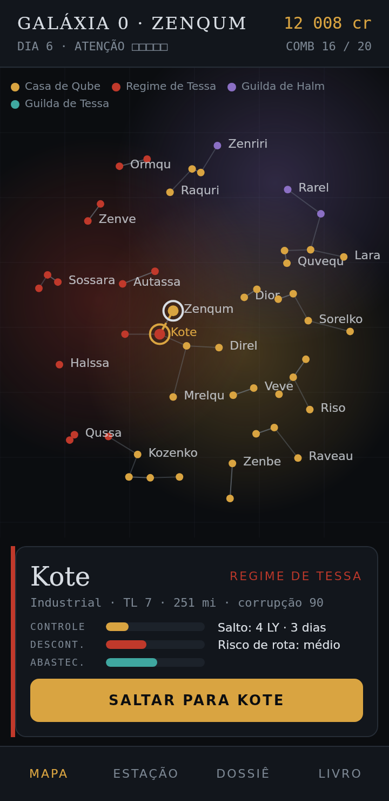 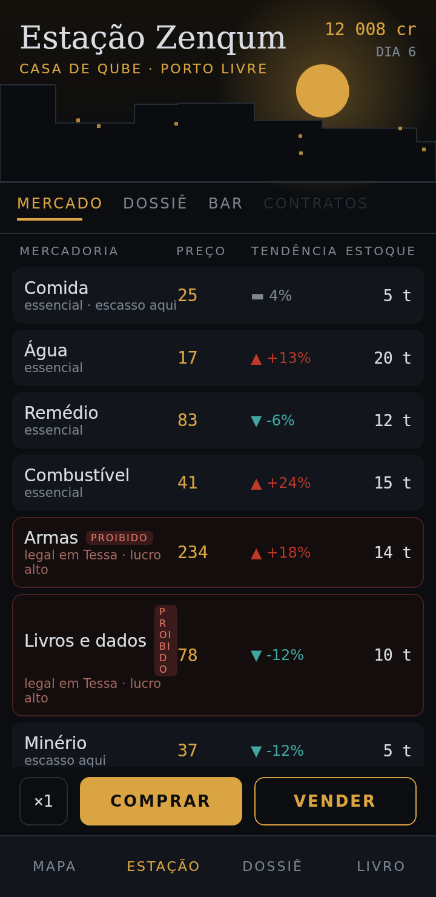 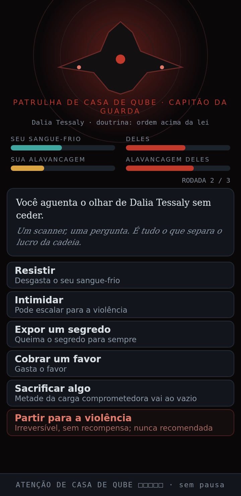 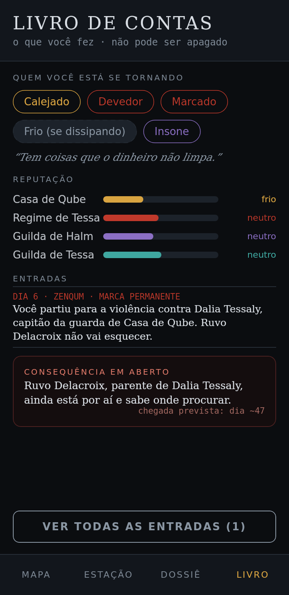

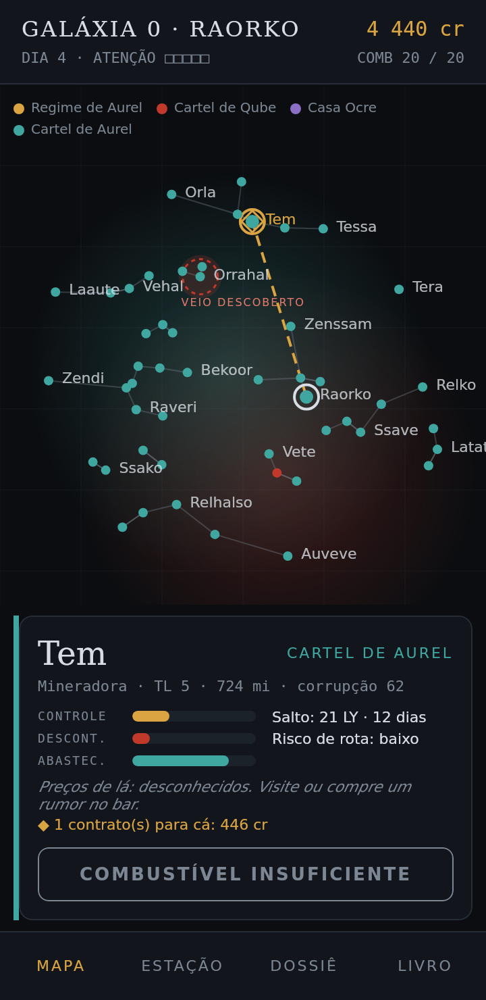 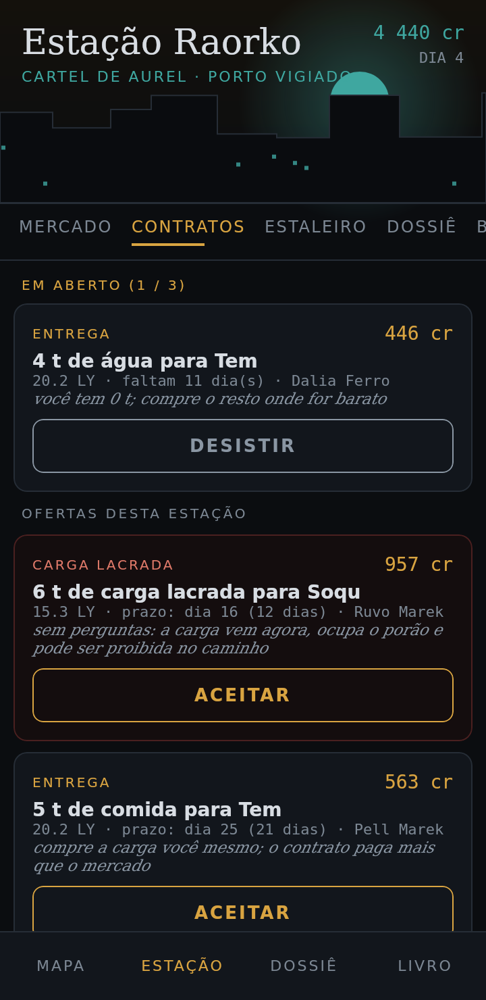 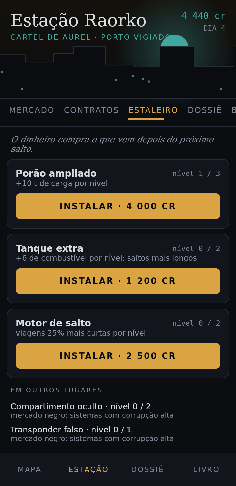 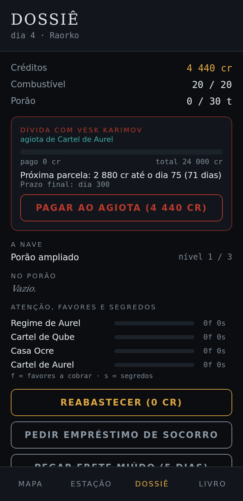 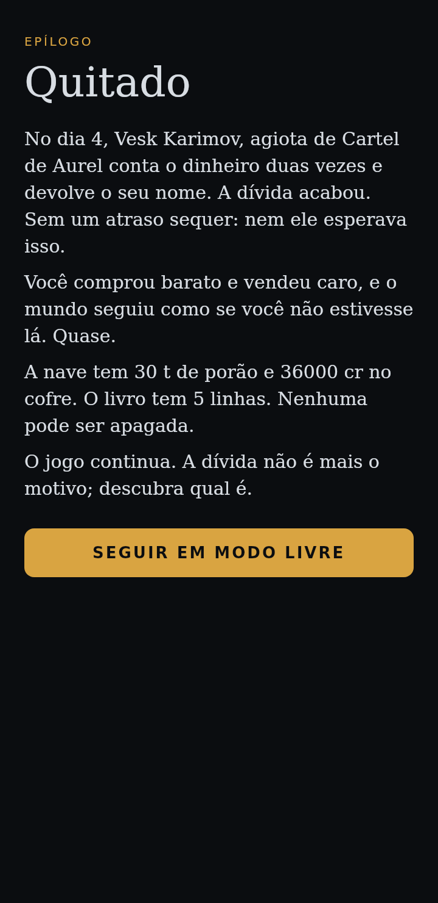

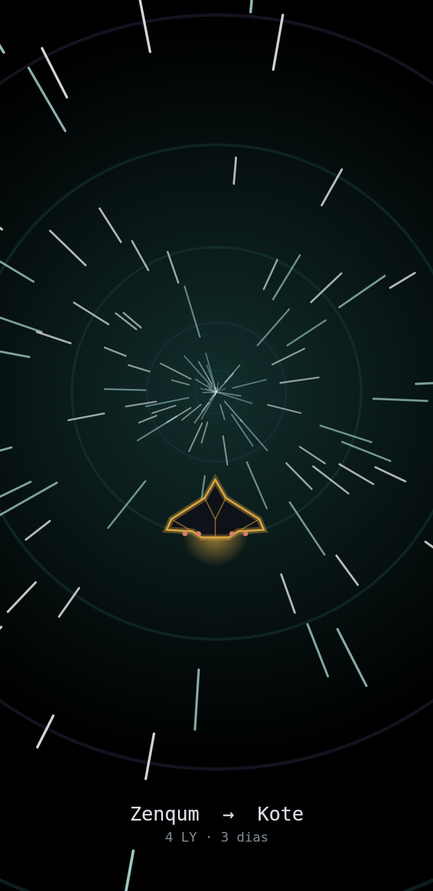 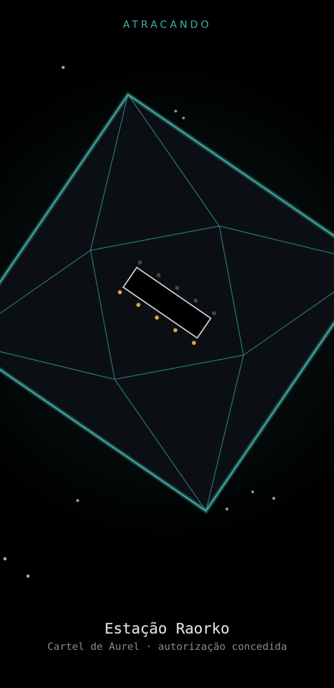 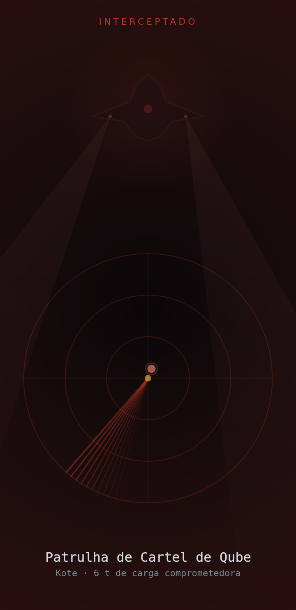 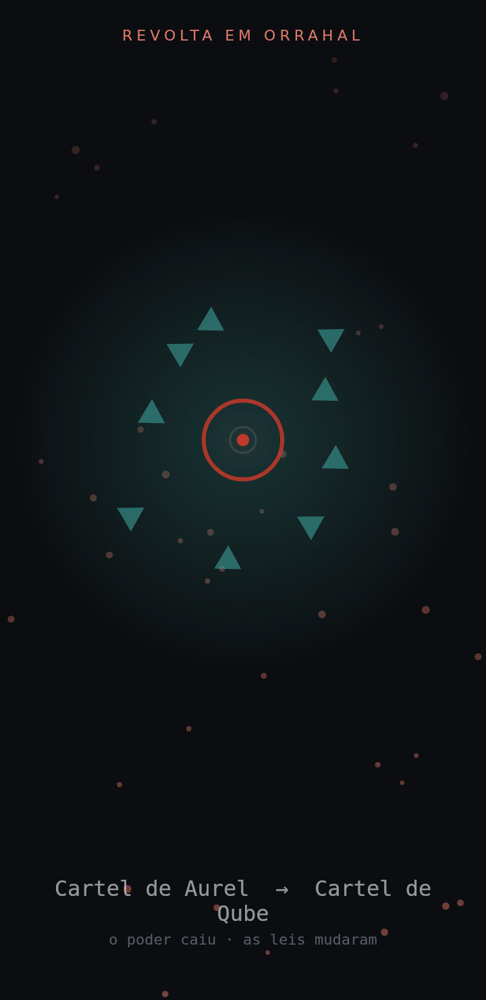 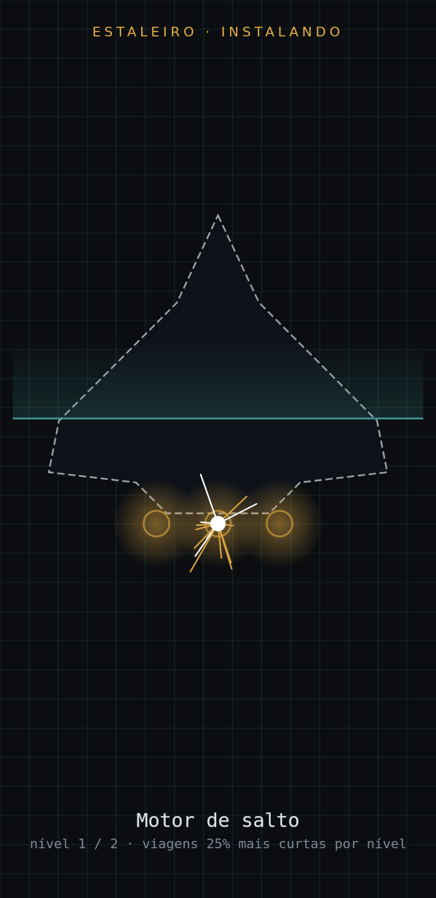

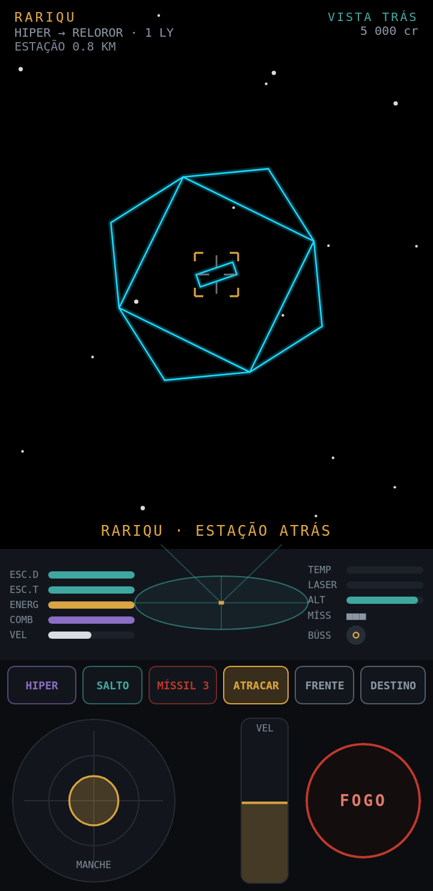 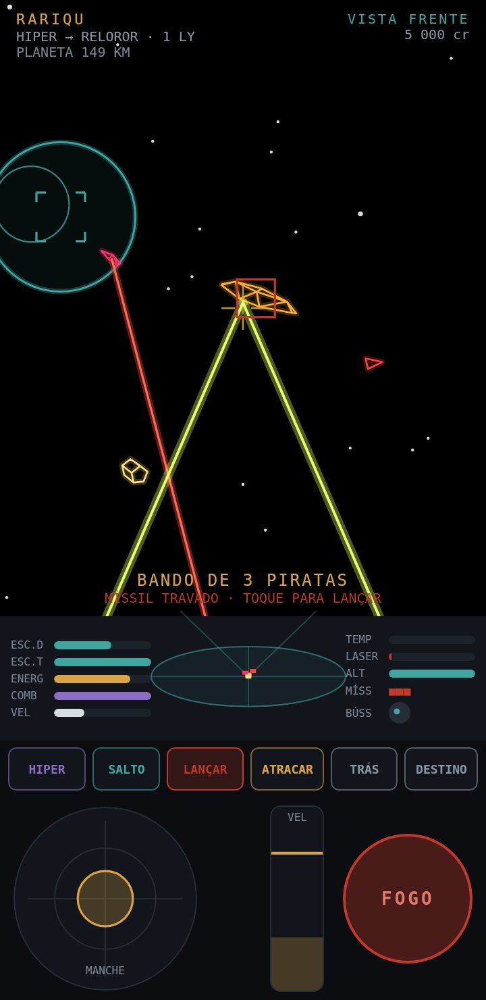 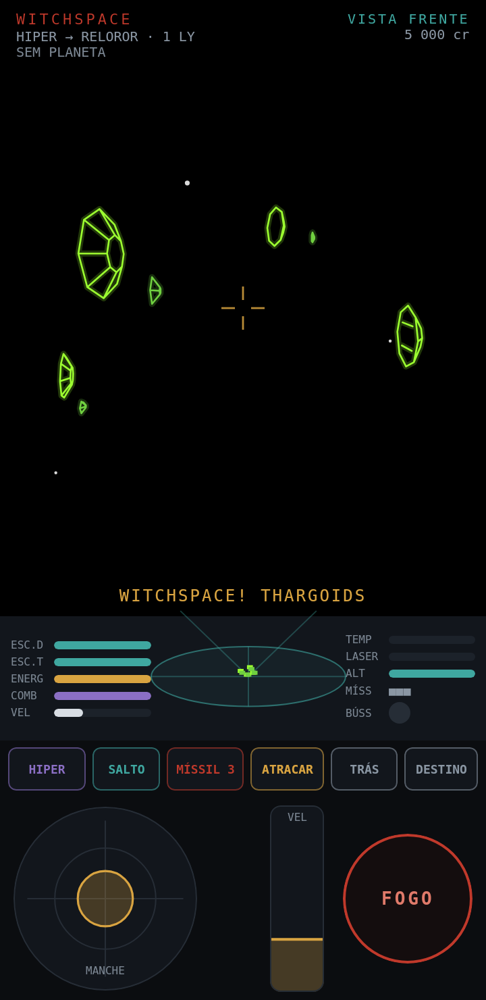
