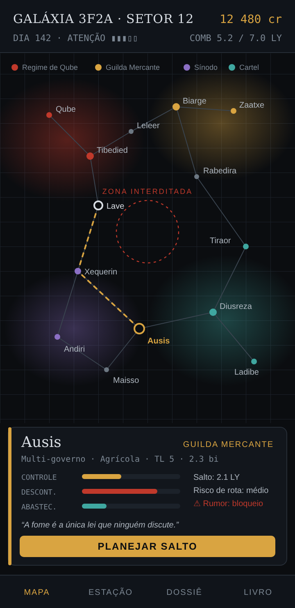
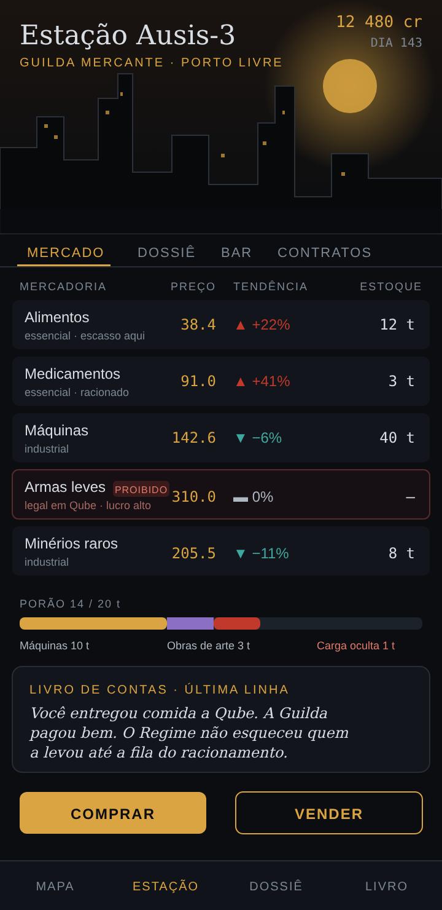
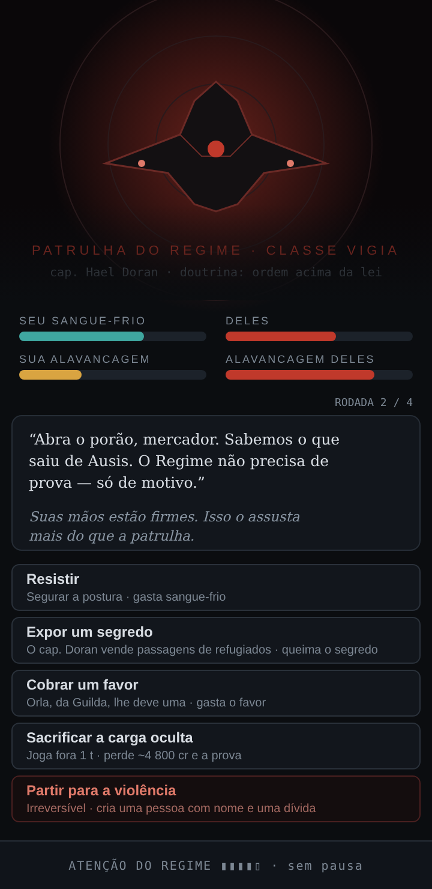
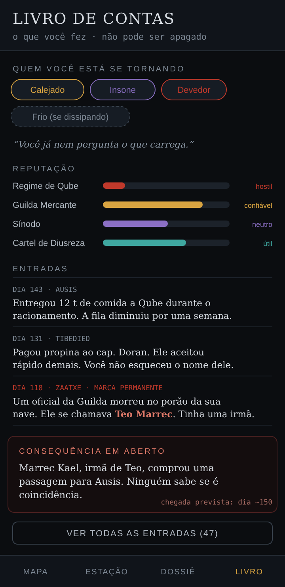

# Design: "O Mercador Cúmplice"

Documento de design de uma modernização do Elite. **Nada aqui está implementado.**
É uma proposta para discussão, escrita a partir de uma conversa de design.

## 1. Visão

Você é um mercador solitário. Compra em um sistema, vende em outro, atravessa espaço
controlado por facções que se odeiam. Carrega mercadorias que o poder local chama de
contrabando e, por isso, passa a ser perseguido.

O jogo mantém a "vibe" do Elite (o laço comprar, viajar, vender, arriscar), mas troca o
combate de tiro por **decisões com custo** e acrescenta **intriga política**.

**Tom:** sombrio, político e introspectivo. O comércio é cumplicidade: levar remédio a um
sistema sitiado, vender armas a uma junta ou carregar a carta de um governador corrupto
são atos com peso moral e efeito no mundo.

**Pilares**

1. **Comércio é política.** O que você carrega muda o mundo, e o mundo reage.
2. **Sem reflexo, sem pontaria.** Tudo se resolve por escolha e custo.
3. **O mundo é uma fórmula, a história é o que se anota por cima.**
4. **Você se transforma.** As consequências ficam em quem você é, e não só em números.

**Decisões já tomadas**

| Tema | Decisão |
|---|---|
| Visual | Moderno e estilizado ("dossiê noir"), 2D |
| Protagonista | Mercador solitário, sem tripulação |
| Tom | Sombrio e político |
| Combate | Sem jogo de tiro; confronto por pressão e escolhas |
| Cicatrizes | Moderadas (ver seção 8) |
| Plataforma | Android nativo, Kotlin |

## 2. Relação com o código atual

O repositório hoje é um remake **fiel** do Elite (algoritmos originais, voo 3D wireframe
e combate em LibGDX). Esta proposta é uma direção **diferente**, não uma evolução natural.

O que dá para reaproveitar, em princípio:

- a organização `core/` em Kotlin puro e testável sem Android SDK;
- a ideia de semente para gerar o mundo (`galaxy/Seed`, `GalaxyGenerator`);
- a economia como ponto de partida (`economy/`).

O que provavelmente não se reaproveita: voo 3D, combate, scanner, HUD e renderização
wireframe.

> **Decisão em aberto (D1):** evoluir este projeto ou iniciar um módulo/projeto novo que
> só reutilize ideias e partes do `core`. Esta avaliação ainda não foi feita (ver seção 12).

## 3. O universo gerado

### 3.1. Árvore de sementes por hash

O Elite gera tudo em fila: para chegar ao planeta 100 é preciso gerar os 99 anteriores
(`Seed.tweak()`). Para escalar, o gerador passa a ser por **hash**, com acesso direto a
qualquer ponto:

```
semente do universo
  └─ galáxia #N              (N pode ser enorme)
      └─ setor (x, y)
          └─ sistema
              ├─ planetas e estações
              ├─ facções que o controlam
              └─ pessoas importantes (governador, contrabandista, patrulheiro...)
```

- Cada nível deriva do pai por hash, sem depender de ordem.
- Gera-se só o que está perto do jogador (geração preguiçosa).
- Meta: milhares de galáxias sem custo de memória relevante.
- Uma boa função de hash/PRNG com acesso aleatório (por exemplo, da família SplitMix)
  substitui a soma de Fibonacci de 6 bytes.

### 3.2. Gerado e vivido

| Camada | O que é | Salvo? |
|---|---|---|
| **Gerado** | Como cada coisa é por natureza (nome, traços, recursos, leis) | Não, é recalculado |
| **Vivido** | O que mudou: preços, quem governa, reputação, embargos | Sim, só as diferenças |

O save guarda apenas **deltas** sobre o mundo-fórmula. Uma base local (Room/SQLite) basta.

### 3.3. Traços de um sistema

O Elite usa regras encadeadas (a tecnologia depende de economia e governo). Isso é o que
dá coerência, e a proposta o estende com mais eixos:

- **Herdados do original:** economia, governo, tecnologia, população, produtividade.
- **Novos:** corrupção, vigilância, estabilidade, ideologia, cultura, recursos raros.
- **Exemplos de regras:** alta corrupção torna o suborno eficaz, mas a polícia imprevisível;
  alta vigilância torna o contrabando arriscado e bem pago.
- **Leis por facção:** a ideologia da facção define a lista de bens proibidos. É essa lista
  que fabrica o contrabando.

Os textos de descrição evoluem da "sopa de cabra" (`GoatSoup`) para gramáticas com mais
peças, que citam traços reais do planeta.

## 4. Política

**Facções** (impérios, guildas, cartéis, corporações) controlam grupos de sistemas.

- A **matriz de relações** entre elas nasce da semente e muda com eventos (guerra,
  embargo, golpe, tratado, epidemia).
- Cada evento altera leis, preços e quem persegue o jogador.
- Cada facção tem uma **doutrina** que define como seus agentes agem (brutal, mercantil,
  burocrática...).

**Reputação por facção:** ajudar uma pode custar a confiança de outra.

**Informação é mercadoria:** rumores e segredos são comprados em bares e valem lucro
(por exemplo, saber de um embargo antes dos outros).

## 5. Economia moral: os três medidores

Cada sistema tem três medidores que evoluem no tempo e com as entregas do jogador:

| Medidor | Significado |
|---|---|
| **Controle** | O quanto o poder local aperta a população |
| **Descontentamento** | A pressão para uma revolta |
| **Abastecimento** | Comida, remédio, armas, combustível |

Cada mercadoria empurra esses medidores: comida baixa o descontentamento, armas aumentam o
controle, remédio ganha lealdade.

O jogo mantém um **livro de contas**: um registro permanente e legível das consequências
("Você foi o último a entregar insulina a Qube antes do bloqueio"). É o principal veículo
do peso moral e dispensa cenas roteirizadas.

## 6. O jogador (estado)

Um único mercador, logo um estado pequeno:

- **Recursos:** créditos, combustível, espaço de carga, tempo.
- **Atenção (heat):** o quanto cada facção está de olho nele.
- **Reputação** por facção.
- **Favores e dívidas** (devidos e a receber).
- **Segredos:** informações usáveis como moeda.
- **Traços e cicatrizes** (seção 8).

## 7. Laço principal

```
Atracar → mercado + dossiê + bar (rumores) + contratos
   → escolher rota (combustível / tempo / risco)
   → saltar → evento (cartão com escolhas)
   → chegar → o mundo reage → repetir
```

### 7.1. Perseguição

A atenção sobe com contrabando ou presença em lugar proibido. Quando uma patrulha alcança
o jogador, ele decide:

| Opção | Efeito |
|---|---|
| **Subornar** | Funciona melhor onde a corrupção é alta |
| **Jogar a carga fora** | Perde o lucro e some a prova |
| **Blefar** | Resultado depende de traços e reputação |
| **Fugir para a base** | Risco e custo de combustível |
| **Entregar-se e negociar** | Custo em reputação e créditos |
| **Confrontar** | Ver seção 8 |

### 7.2. Zonas proibidas

O "espaço proibido" vira **zonas controladas por facção** ou anomalias, com risco e
recompensa próprios.

### 7.3. Eventos de viagem

Cada salto pode gerar um encontro (patrulha, mercador em apuros, sinal estranho) como
cartão com escolhas. O sorteio depende da rota e do dia, então o jogo é determinístico e
testável, mas não repetitivo.

## 8. Confronto (sem tiro)

O confronto é uma **cena em rodadas** (em geral 3 a 5), não uma luta em tempo real.

### 8.1. Medidores da cena

- **Sangue-frio:** quando chega a zero, o lado cede.
- **Alavancagem:** o que cada lado tem contra o outro (provas, favores, posição, carga).

### 8.2. Posturas por rodada

| Postura | Disponibilidade | Custo ou risco |
|---|---|---|
| Resistir | Sempre | Desgasta o sangue-frio |
| Intimidar | Se há fama de perigoso | Pode escalar a violência |
| Expor um segredo | Se há informação sobre o oponente | Queima o segredo para sempre |
| Cobrar um favor | Se alguém deve algo | Gasta o favor |
| Sacrificar algo | Sempre | Perde carga, nave ou credibilidade |
| Partir para a violência | Sempre, nunca recomendada | Irreversível |

Os resultados vêm de números do jogo (traços, reputação, medidores do sistema) com sorteio
determinístico, para os testes poderem reproduzir qualquer cena.

### 8.3. O oponente nasce do mundo

Depende da **doutrina da facção** e dos traços do sistema (corrupção, vigilância). Uma
patrulha de regime brutal atira primeiro; uma guilda mercantil prefere negociar; um cartel
cobra dívida. O confronto é sempre contra um poder específico.

### 8.4. Consequências: cicatrizes **moderadas**

Decisão tomada: a maioria dos danos é recuperável.

| Tipo | Regra |
|---|---|
| Dano à nave e ao jogador | Recuperável com tempo e dinheiro |
| Traços (*Calejado*, *Insone*, *Frio*, *Devedor*) | Surgem de atos, abrem e fecham opções; alguns se dissipam com o tempo |
| Violência | **Única fonte de marcas permanentes** |
| Livro de contas | Toda cena vira uma linha que nunca é apagada |
| Voz interior | Frases curtas de monólogo reagem ao que o jogador fez |

**A violência tem rosto.** Escolher a violência:

- cria uma pessoa com nome (família, superior, facção) que pode retaliar meses depois no jogo;
- altera fama e traços de forma permanente;
- não dá nenhuma recompensa material.

Um modo "difícil" opcional pode adotar cicatrizes severas (danos graves permanentes), mas
fica fora do escopo inicial.

## 9. Narrativa procedural: storylets

A história vem de **storylets** (modelo de *Fallen London* e *Sunless Sea*): eventos
curtos escritos com **condições** sobre o estado do mundo ("só em sistema com alto controle
e descontentamento, se a reputação com a facção local é baixa").

- O motor sorteia, a cada chegada ou salto, uma storylet cujas condições são satisfeitas.
- O texto tem lacunas preenchidas pelo mundo (nome do governador, facção rival).
- O confronto é um tipo especial de storylet, com rodadas.
- Meta de conteúdo: cerca de 100 a 200 storylets bem escritas para dar a sensação de
  milhares de histórias.

## 10. Visual e tecnologia

**Visual: "dossiê noir"**

- Interface escura, tipografia forte, uma cor de destaque por facção.
- Mapa da galáxia como mesa de inteligência (rotas, zonas de influência em manchas de cor).
- Estações como ilustrações 2D estilizadas, com menus por cima.

**Tecnologia (Android nativo, Kotlin)**

- **Núcleo em Kotlin puro** (geração, economia, facções, storylets), sem dependência de
  Android, testável no computador.
- **Interface em Jetpack Compose** com Canvas para o mapa; sem motor 3D.
- **Room/SQLite** apenas para os deltas do mundo vivido.

### 10.1. Protótipo visual (conceito)

As quatro telas abaixo são **maquetes de conceito** para dar uma noção do jogo. Não há
código por trás delas, e nomes, números e textos são exemplos. O formato é retrato de
celular (360 × 740 dp). Os arquivos-fonte (`.svg`) ficam em `docs/mercador/` e podem ser
editados.

**Regras visuais que as telas mostram**

- Fundo quase preto, texto em cinza-claro; títulos em serifa, dados em monoespaçada.
- **Uma cor por facção**, usada em todo lugar (mapa, cartões, reputação):
  âmbar = Guilda Mercante, vermelho = Regime de Qube, violeta = Sínodo, verde-água = Cartel.
- Vermelho também significa perigo (proibido, hostil, violência), por isso o vermelho do
  Regime fica sempre ligado a esse sentido.
- Os medidores (controle, descontentamento, abastecimento, sangue-frio, alavancagem) são
  barras finas, sempre com rótulo e nunca só cor.
- A voz interior e o livro de contas usam serifa em itálico, como anotações.

**1. Mapa da galáxia: a mesa de inteligência**



Manchas de cor mostram a influência de cada facção. A linha tracejada é a rota planejada,
o círculo vermelho tracejado é uma zona interditada, e o cartão de baixo resume o sistema
selecionado (facção, traços, três medidores, risco da rota e um rumor).

**2. Estação: mercado com consequências**



A ilustração 2D dá o clima da estação, e o menu fica por cima. Os preços mostram a
tendência e o motivo ("escasso aqui", "racionado"). Mercadoria ilegal no local aparece
marcada, mas continua lucrativa, e o porão mostra a **carga oculta**. A última linha do
livro de contas aparece ali, para o jogador nunca esquecer o que fez.

**3. Confronto: sem tiro, só pressão**



O oponente é uma pessoa, com nome e doutrina. Os quatro medidores mostram a cena (sangue-
frio e alavancagem dos dois lados). As opções são as posturas da seção 8, cada uma com seu
custo escrito. A violência é a última opção, em vermelho, e avisa que é irreversível. A
cena não pode ser pausada, para manter a tensão.

**4. Livro de contas: quem você está se tornando**



Traços (alguns se dissipam, em tracejado), reputação por facção, entradas permanentes e
**consequências em aberto**: aqui, a irmã de alguém que morreu no seu porão está a caminho.
É a parte introspectiva do jogo.

## 11. Roteiro de construção

Cada etapa já é jogável. Se a etapa 2 não for divertida, o resto não se salva; por isso
ela é validada cedo.

1. **Dados e gerador** em Kotlin puro, com testes: universo, sistemas, facções, mercadorias.
2. **Laço de comércio** numa região pequena (~50 sistemas, ~12 mercadorias), com os
   medidores de controle, descontentamento e abastecimento.
3. **Leis, atenção e perseguição** por decisões, sem o confronto ainda.
4. **Confronto por rodadas, traços e livro de contas.**
5. **Storylets** e a voz interior.
6. **Polimento visual** do dossiê noir.

**Fatia vertical inicial:** 1 região, 3 facções, ~12 mercadorias, ~10 tipos de evento.

## 12. Riscos e perguntas em aberto

| # | Item |
|---|---|
| D1 | Evoluir este projeto ou iniciar um novo? Falta avaliar o que de `economy/`, `missions/` e `galaxy/` é reaproveitável. |
| R1 | **Infinito não é divertido por si só.** Muitas galáxias vazias cansam; o que prende são poucos sistemas com significado. |
| R2 | **Equilíbrio.** Economia dinâmica e política podem quebrar (preços descontrolados, uma facção que domina tudo); exige simulação de longo prazo nos testes. |
| R3 | **Volume de texto.** O tom sombrio depende de boa escrita; storylets são conteúdo, não só código. |
| R4 | **Peso moral sem moralismo.** O jogo registra e cobra consequências, mas não deve julgar o jogador. |
| Q1 | Quantas facções e quantos tipos de mercadoria no protótipo? |
| Q2 | Qual é a condição de "fim" da campanha, se houver? |
